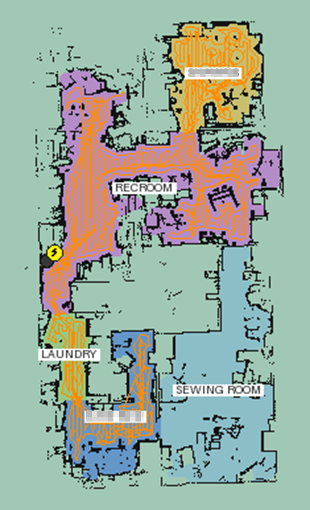

# Eufy Clean — Home Assistant Integration

Full-featured Home Assistant custom component for Eufy robot vacuums. Controls cleaning scenes, individual rooms, dock station, and streams a live floor map — via MQTT, local Tuya or Tuya Cloud, with local P2P maps and camera video on supported robots.

[](https://github.com/hacs/integration)
[](https://github.com/jeppesens/eufy-clean/releases)
[](https://github.com/jeppesens/eufy-clean/commits/main)
[](LICENSE)
[](https://github.com/jeppesens)
[](https://github.com/jeppesens/eufy-clean/actions/workflows/hassfest.yaml)
[](https://github.com/jeppesens/eufy-clean/actions/workflows/hacs_validation.yaml)

> ⭐ **Help others find this integration!** If it's working well for you, please star this repository.
>
> [](https://github.com/jeppesens/eufy-clean/stargazers) [](https://github.com/jeppesens/eufy-clean/network/members)

---

## FAQ
- Supports MQTT robots and Tuya-transport robots such as the S1 Pro — see the supported models and transport setup below.
- Tested on X10 Pro Omni, C28 Omni and S1 Pro; available features depend on the model and transport.
- Personal project maintained for Home Assistant users. Contributions welcome!

> [!NOTE]
> This integration is a fork of [martijnpoppen/eufy-clean](https://github.com/martijnpoppen/eufy-clean) with significant new features added, including a live floor map camera, error notifications, off-peak charging, and more.

---

## Features

### Live Floor Map Camera
A live floor plan camera entity (`camera.<device>_map`) streams the robot's map via MQTT or local P2P on Tuya robots. It uses the configured Eufy/Tuya account; no Tuya developer account is needed.



- **Room-coloured rendering** — rooms colour-coded and labelled with names from the Eufy app
- **No-go zones and virtual walls** — forbidden zones (red), ban-mop zones (orange), virtual walls (red lines) as overlays
- **Live robot position** — tracks position in two styles: orange with googly eyes (default) or plain dark dot
- **Dock icon** — a house icon marks the dock; robot snaps to it when docked
- **Status badge** — a coloured badge next to the robot shows charging, washing, drying or emptying
- **Cleaning trail** — a line traces the robot's path; clears on new session, survives HA restarts, preserved across brief auto-empty dock visits
- **Persistent map** — map and room data saved to storage and restored on restart

Map size (256/512/1024/2048 px) and robot marker style configurable via integration options.

### Robot Camera (S1 Pro)
`camera.<device>_camera` shows the robot's own camera (H.265, 800x600 at about 10 fps) as a snapshot and an MJPEG stream, over the same local P2P connection as the map. HA MJPEG is limited to about 5 fps. Requires the local Tuya transport and an `ffmpeg` on the Home Assistant host (the stock container has one).

- **Switched on at the robot, never from Home Assistant.** The camera is off until you hold **Start/Pause** and **Recharge** together for 10 seconds on the robot. The integration only reads that switch (`binary_sensor.<device>_camera_enabled`); the camera entity is unavailable while it is off.
- **Only streams while someone is looking.** The first viewer opens the stream, it stays warm for 20 seconds, and the last viewer to leave closes it again.
- **Manual control must be enabled.** Start it with `vacuum.send_command` and `command: start_remote`; end it with `command: stop_remote`. The camera is unavailable outside manual control and never changes the mode itself. Leaving manual control closes the stream and prevents cached images from being returned.
- **Stationary manual mode can expire after about a minute.** Viewing does not renew it. The map pauses while video owns the P2P session slot.
- **Night views are dark.** There is no light on the robot.

Protocol notes and discarded experiments: [P2P channel notes](docs/P2P_MAP_CHANNEL.md).

### Vacuum Control
- **Start / Stop / Pause** cleaning operations
- **Return to dock** command
- **Scene Selection** — trigger pre-configured cleaning scenes via select entity or service call
- **Room-specific cleaning** — clean individual rooms or combinations
- **Battery monitoring** — level and charging status
- **Find Robot** — locate device by playing a sound

### Cleaning Parameters
Select entities exposed per device (hidden until supported DPS fields are received):

| Entity | Options |
|--------|---------|
| Suction Level | Quiet, Standard, Turbo, Max, Boost IQ |
| Cleaning Mode | Vacuum, Mop, Vacuum and mop, Mopping after sweeping |
| Water Level | Low, Medium, High |
| Mop Intensity | Quiet, Automatic, Max *(Matter-compatible alias for Water Level)* |
| Cleaning Intensity | Normal, Narrow, Quick |
| Voice Language | 17 languages: English, German, French, Spanish, Japanese, and more |

### Dock Tasks
Action buttons for: **Wash mop**, **Dry mop**, **Stop dry mop**, **Empty dust bin**

### Dock Configuration

| Setting | Options |
|---------|---------|
| Wash Frequency Mode | ByRoom / ByTime |
| Wash Frequency Value | 15–25 minutes |
| Auto Mop Washing | On / Off |
| Dry Duration | 2h / 3h / 4h |
| Auto Empty | On / Off |
| Auto Empty Mode | Smart, 15 / 30 / 45 / 60 min |
| Off-Peak Charging | On / Off + start/end time |

### Error Notifications
Sends a notification when the robot reports an error (Wheel Stuck, Sensor Dirty, etc.):

- **Desktop notification** (toggle) — shows in the HA bell icon, auto-dismissed when the error clears
- **Mobile push** (dropdown) — pick your phone from discovered Companion App devices or type a service name; leave blank to skip mobile alerts

> [!NOTE]
> Error codes are reported by the **robot** via MQTT. Dock hardware faults (error light on the station) use a separate channel not currently accessible via MQTT and will not trigger notifications.

The vacuum entity also exposes `error_codes` and `warn_codes`, the lists from the robot's latest error report. `error_code` is the first non-zero code in `error_codes`, then the robot's newly raised faults, then `warn_codes`, so it can hold a warning. Either list can contain a fault. Both lists stay empty on scalar and legacy devices, so use `error_code` there.

### Sensors

| Sensor | Notes |
|--------|-------|
| Battery level | % |
| Charging status | Binary |
| Work status & mode | Retained across docking |
| Cleaning area | Retained until next clean |
| Total cleaning area / time / count | Lifetime stats |
| Dock firmware version | Station FW |
| Error code & description | Real-time |
| Accessory life remaining | Filter and brushes; sensors, mop, cleaning tray, dust bag and sewage tank filter on models whose lifespan table lists them (hours) |

**Extended device info:** Serial number, MAC address, firmware version in the HA device panel.

#### Current Room

Novel MQTT vacuums with a live map stream expose a **Current Room** sensor
(`sensor.<device>_current_room`). It reports the robot's physical room using its
live map position and room mask, with `room_id` and `room_name` attributes.
The sensor updates when the resolved room changes, independently of the selected
cleaning target. Tested on the Eufy X10 Pro Omni.

The state is `unknown` until a valid position and room mask are available. An
unnamed room displays `Room <ID>`. Doorway boundaries can briefly resolve to
`unknown`; if the position stream stops, the last known location may remain.
After switching maps, the position can remain in the previous coordinate frame
until the robot moves and re-localizes.

### Accessory Reset Buttons
Dedicated reset buttons for each consumable (filter, side brush, rolling brush, sensors, mop, cleaning tray).

> [!NOTE]
> The Eufy app shows a "Replace" tab (replacement life) and a "Maintain" tab (cleaning intervals). With the default lifespans and the Omni E35's, **Sensor Remaining** and **Cleaning Tray Remaining** follow the Maintain tab and the other accessory sensors follow Replace, so the app's other Maintain values (e.g. cleaning the brushes or filter) aren't exposed. The S1 Pro's lifespans come from its app accessory table and are mostly cleaning intervals; its Filter Remaining, for example, counts down a 60 h filter-cleaning interval. All are computed from the robot's own usage counters.

### Segment Change Detection
When rooms are added, removed, or renamed, the integration raises a **Repair issue** under Settings → System → Repairs. Useful if you use [home-assistant-matter-hub](https://github.com/RiDDiX/home-assistant-matter-hub).

### Matter Hub Support
Room segments with guaranteed unique names (duplicates auto-suffixed, e.g. `Kitchen (2)`). **Mop Intensity** uses Matter-compatible option names (`Quiet`, `Automatic`, `Max`).

---

## Supported Devices

| Series | Models |
|--------|--------|
| X-Series | T2261, T2262, T2266, T2276, T2320, T2351 (X8, X8 Pro, X9 Pro, X10 Pro Omni) |
| C-Series | T1250, T2117, T2118, T2120, T2128, T2130, T2132, T2280, T2292 (C20, C28 Omni) |
| L-Series | T2190, T2267, T2268, T2278 (L60, L70) |
| G-Series | T2210–T2278 (G20, G30, G35, G40, G50) |
| S-Series | T2119, T2080, T2080A (RoboVac 11S, S1, S1 Pro) |

---

## Installation

[](https://my.home-assistant.io/redirect/hacs_repository/?owner=jeppesens&repository=eufy-clean&category=integration)

1. Click the button above → **Open Link** → **Add** in HACS
2. Click **Download** (bottom right) → **Download** on the version prompt
3. Restart Home Assistant
4. Add the integration:

[](https://my.home-assistant.io/redirect/config_flow_start/?domain=robovac_mqtt)

5. Enter your Eufy account email and password

> [!NOTE]
> This integration requires the [Pillow](https://python-pillow.org/) image library for live map rendering. Pillow ships with Home Assistant itself — no manual action needed.

---

## Options (gear icon)

| Setting | Default | Notes |
|---------|---------|-------|
| Map image size | 1024 px | 256 / 512 / 1024 / 2048 px |
| Robot marker style | Googly Eyes | Googly Eyes / Dot |
| Desktop notification | Off | HA bell icon on robot errors |
| Mobile notification service | *(blank)* | Select phone or type `mobile_app_name`; blank = disabled |

> [!TIP]
> Changes made via HA may not appear in the Eufy mobile app immediately — navigate away and back in the app to refresh the state.

---

## Usage

### Optional: Local Tuya transport (push, no 30 s polling)

For devices the Eufy API reports as **non-MQTT** (served over the **Tuya Cloud**
path and otherwise polled every 30 s) you can opt-in to a direct **LAN socket**
on the dock instead. Whether a device uses this path is decided per-device at
runtime from the Eufy API's `mqtt` flag — not by model name — so open
**Configure** to see which of your devices are eligible. Updates then arrive
within seconds of the device emitting them and continue to work while the
Eufy / Tuya cloud is unreachable.

How to enable it:

1.  Find the **LAN address** of your dock — DHCP reservation, your router's
    device list, or a quick `nmap -sn 192.168.1.0/24`. The local key is
    auto-supplied by the Tuya Cloud login, you don't need to extract it.
2.  Go to Settings → Devices & Services → **Eufy Robovac MQTT** → **Configure**.
3.  Enter the host (IP or DNS name) for each cloud-discovered vacuum and
    pick the Tuya protocol version (3.3 fits most vacuums; try 3.4/3.5 if
    your model is newer and 3.3 fails to connect). The live P2P map, room
    list and camera need 3.3; on 3.4/3.5 they stay off.
4.  Save. The integration reloads and switches that device to local push.

If the local socket fails to open (wrong host, firewall, dock offline) the
coordinator silently falls back to cloud polling, so the dashboard never goes
unavailable just because the LAN address has shifted.

> [!WARNING]
> **Security model.** The local transport is AES-encrypted with your device's
> **local key** — it is *not* TLS and performs no certificate validation, so it
> is intended for a **trusted LAN only**. The local key grants full local
> control of the dock and is a secret: never share it, and never paste
> integration debug logs that might contain it into public issues.

> [!NOTE]
> On Tuya-transport devices the map, rooms and cleaning path are not on any DPS.
> They come from one of two sources:
>
> - **Tuya cloud map** (legacy robots such as the T2266): the map is downloaded
>   from Tuya cloud storage, and the live position and cleaning trail arrive on a
>   separate Tuya channel. Both need cloud access, with or without the LAN
>   transport.
> - **Local P2P channel**: on the local Tuya transport the integration keeps a
>   P2P session open on the LAN (streaming while the robot moves, refreshing
>   while it rests) and decodes it.
>
> Either way you get the same experience as on MQTT robots:
>
> - the room list with the names set in the app (room cleaning, HA areas/segments,
>   the room select, tap-a-room on the bundled card);
> - a live floor-map camera with room colours and labels, the robot's position
>   and heading, the cleaning path, obstacles, restricted zones and the rooms
>   being cleaned;
> - the active map id, so room and zone commands target the right map.
>
> The P2P feed is verified end to end on the S1 Pro (T2080A). Other robots on
> local Tuya 3.3 start the feed too and so get the map camera, but only the S1
> Pro is verified to send a map over it. The channel is documented in
> `docs/P2P_MAP_CHANNEL.md`. The P2P password comes from your Tuya Cloud session,
> so each new P2P connection needs a fresh cloud-issued session. The feed needs
> Tuya protocol 3.3 and a Tuya Cloud session. On a robot without the Tuya cloud
> map, without them and over Tuya Cloud polling no map arrives: the map camera
> isn't created, and `zone_clean` fails with an error unless a map from an
> earlier session with the feed is still stored. Everything else (vacuum/mop
> mode, water level, spot and room commands, station, consumables, lifetime
> stats) works over both transports.

### Optional: Manual room name overrides

The room list (and the `select.robovac_clean_room` entity that targets it) is
fetched automatically over the local P2P channel on Tuya devices. If that path
is unavailable (no Tuya cloud session, or a device that does not answer), you can
supply your own `room_id: name` mapping instead:

1.  Settings → Devices & Services → **Eufy Robovac MQTT** → **Configure**.
2.  In the **Rooms** field for your vacuum, enter one room per line:
    ```
    1: Lounge
    2: Kitchen
    3: Playroom
    ```
3.  Save. The `Clean Room` select entity reappears with your names as the
    options. Selecting one fires `room_clean` with the matching ID.

Finding the IDs is iterative until someone wires up MQTT-side discovery for
Tuya devices: try `1, 2, 3, ...` and watch which room the vacuum starts on
each, then adjust the mapping. The IDs are stable across sessions (they
change only when the dock re-maps the floor plan).

Overrides also work on the MQTT transport — useful if the auto-discovered
names from the device aren't friendly enough for your dashboard.

### Cleaning Scenes

```yaml
action: vacuum.send_command
data:
  command: scene_clean
  params:
    scene_id: 5
target:
  entity_id: vacuum.eufy_omni_c28
```

Default scenes are typically 1–3; custom scenes start at 4+. Find IDs in the **Scene/Task** select entity.

### Whole-house clean count (x1 / x2)

Use `start_auto` with `clean_times: 2` to request two whole-house cleaning passes.
Omit `clean_times` or set it to `1` for a single pass.
Other values are clamped to 1 or 2, with a warning in the log.
This option applies to novel-protocol devices; scalar and legacy (Tuya Cloud plain-value) devices ignore `clean_times`.

```yaml
action: vacuum.send_command
target: { entity_id: vacuum.eufy_clean }
data: { command: start_auto, params: { clean_times: 2 } }
```

### Room Cleaning

```yaml
action: vacuum.send_command
target:
  entity_id: vacuum.eufy_omni_c28
data:
  command: room_clean
  params:
    map_id: 4
    room_ids: [3, 4]
    fan_speed: "Turbo"
```

### Multi-Room Custom Settings

```yaml
action: vacuum.send_command
target:
  entity_id: vacuum.eufy_omni_c28
data:
  command: room_clean
  params:
    map_id: 4
    rooms:
      - id: 3       # Kitchen
        fan_speed: "Turbo"
        clean_mode: "vacuum_mop"
        water_level: "High"
      - id: 4       # Hallway
        fan_speed: "Quiet"
        clean_mode: "vacuum"
```

### Zone Cleaning

Clean one or more free-form rectangles instead of whole rooms. Each zone is given as
normalized coordinates `[x0, y0, x1, y1]` — fractions (`0`–`1`) of the rendered map
image, with `(0, 0)` at the **top-left** and `(1, 1)` at the **bottom-right** of the map
camera image. They are converted to the robot's world frame against the current map, so the
map must have been received at least once (run a clean or dock first). The map only arrives
over Eufy MQTT or the local P2P feed. Over Tuya Cloud polling (or local Tuya without the feed)
`zone_clean` fails with an error, unless a map from an earlier session with the feed is still
stored; use `room_clean` there instead.

```yaml
action: vacuum.send_command
target:
  entity_id: vacuum.eufy_omni_c28
data:
  command: zone_clean
  params:
    zones:
      - [0.05, 0.70, 0.35, 0.95]   # bottom-left corner of the map
      - [0.40, 0.40, 0.60, 0.60]   # a box in the centre
    clean_times: 1
```

`map_id` is taken from the current map automatically; pass it explicitly to override. The
robot uses its current cleaning mode (vacuum / mop) and fan settings for the zone run.

#### Drawing zones — bundled card

Hand-writing normalized coordinates is fiddly, so the integration **bundles a small
Lovelace card** that lets you drag the boxes on the live map instead. It ships inside the
integration and is **auto-registered on setup** — there's no `www/` copy and no Lovelace
*Resources* entry to add. Just drop it on a dashboard:

```yaml
type: custom:zone-clean-card
vacuum: vacuum.eufy_omni_c28
camera: camera.eufy_omni_c28_map
# title: Zone Clean      # optional
# selects:               # optional — defaults to auto-discovering the vacuum's selects
#   - select.eufy_omni_c28_cleaning_mode
#   - select.eufy_omni_c28_clean_speed
```

Draw up to 10 boxes, set suction/mode via the surfaced `select` entities, and hit **Clean**
— it fires the `zone_clean` send_command shown above. The map only renders after the robot
has cleaned once (or you've edited the map in the app).

### Map and Room IDs
- **Active Map sensor** — `sensor.<device>_active_map` shows the current map ID (needed for service calls)
- **Room IDs** — available in the vacuum entity's `rooms` / `segments` state attributes; inspect via **Developer Tools → States**

> [!TIP]
> "Unable to identify position" usually means the `map_id` doesn't match the vacuum's current map. Check the Active Map sensor.

---

## Known Limitations

- **Robot position not shown on first install** — appears after the first cleaning run or docking event. No MQTT command exists to request current position while idle.
- **Dock hardware faults** — error light on the station itself is not exposed via MQTT and will not trigger notifications.
- **Map switching** — not supported; switch maps in the Eufy app.

---

## Development

### Documentation

| Document | Contents |
|----------|----------|
| [`docs/ARCHITECTURE.md`](docs/ARCHITECTURE.md) | layers, transports, datapoint map, state model, entity platforms |
| [`docs/MAP.md`](docs/MAP.md) | how the floor map, live pose and cleaning trail are obtained and drawn |
| [`docs/MAP_WS_CONTRACT.md`](docs/MAP_WS_CONTRACT.md) | the map websocket wire format |

### Local Testing
A `docker-compose.yml` is included for local development:

```bash
docker compose up
```

Starts a local HA instance at `http://localhost:8123` with the component mounted from `custom_components/robovac_mqtt/`.

### Running Tests

```bash
pip install -r requirements_test.txt
pytest
pytest tests/test_parser.py -v
```

### Lint

```bash
pre-commit run --all-files
mypy custom_components/robovac_mqtt/
```

---

## Support

- **Issues:** [GitHub Issues](https://github.com/jeppesens/eufy-clean/issues)

---

## Credits & Attribution

- **Original Integration:** [@martijnpoppen](https://github.com/martijnpoppen) — created the foundation
- **Maintainer:** [@jeppesens](https://github.com/jeppesens) — ongoing maintenance and improvements
- **Contributor:** [@smcneece](https://github.com/smcneece) — live map camera, error notifications, off-peak charging, and additional sensors

## Codeowners

- **[@jeppesens](https://github.com/jeppesens)** — active maintainer
- **[@m11tch](https://github.com/m11tch)** — codeowner

---

## License

MIT License. See [LICENSE](LICENSE). This integration is not affiliated with or endorsed by Eufy / Anker Innovations. Use at your own risk; no warranty is provided.

---

<!-- SEO Keywords
eufy, eufy clean, eufy robovac, eufy vacuum, home assistant, hacs, custom component,
robot vacuum, eufy x10 pro omni, eufy c28 omni, eufy x9 pro, eufy l70, eufy g50,
eufy mqtt, robovac mqtt, room cleaning, floor map, live map, eufy integration,
home assistant vacuum, eufy home assistant, anker eufy, robot vacuum automation
-->

For S1 Pro screen codes and the optional bounded docking retry automation, see
[Docking recovery](docs/DOCKING_RECOVERY.md).
